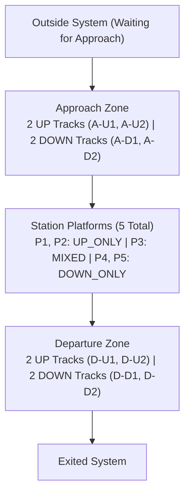

# Concurrent Railway System Simulator

A real-time concurrent railway station simulator that models **12 trains** of varying priorities moving simultaneously through shared **approach tracks**, **typed station platforms**, and **departure tracks** without collisions or deadlocks.

The project includes two parallel implementations of the same 12-train schedule and synchronization model:
1. **Multithreaded Windows Console Engine** (`system_win.c`, `system_win.cpp`, `system_win.exe`) using native Win32 concurrency primitives.
2. **Interactive Web Visualizer** (`index.html`) built with HTML5, TailwindCSS, and async JavaScript to animate train movement, live logs, and delay analytics directly in the browser.

---

## Key Features

- **Concurrent Train Routing:** Simulates 12 independent trains operating simultaneously across 4 approach tracks, 5 platforms, and 4 departure tracks (`1 real second = 1 simulated minute`).
- **Typed Platform Allocation:** Automatically routes trains to dedicated platforms first (`UP_ONLY`, `DOWN_ONLY`) and falls back to a shared `MIXED` overflow platform (`P3`) when needed.
- **Priority-Based Scheduling:** Express trains (`EXPRESS_PASS`, `EXPRESS_HALT`) take precedence over `LOCAL_STOP` trains waiting in the same direction.
- **Deadlock Prevention:** Enforces a strict one-way resource acquisition order (`Approach → Platform → Departure`), releasing each zone immediately upon entering the next.
- **Real-Time Analytics & Visualization:** Live event log, animated zone view, and a final performance table comparing scheduled vs. actual docking/departure times and delays.

---

## Station Layout & Flow



---

## Train Types & Rules

| Train Type | Halt Duration | Priority | Description |
| :--- | :---: | :---: | :--- |
| `EXPRESS_PASS` | 1 min | High | Fast pass-through train; prioritized over local trains |
| `EXPRESS_HALT` | 10 min | High | Long-stop express train; prioritized over local trains |
| `LOCAL_STOP` | 2 min | Standard | Yields platform access if an express train in the same direction is waiting |

---

## Concurrency Model

| Resource | Console Engine (Win32 C/C++) | Web Visualizer (JavaScript) |
| :--- | :--- | :--- |
| **Trains (12)** | Independent OS threads (`CreateThread`) | Concurrent `async`/`await` tasks (`Promise.all`) |
| **Approach & Departure Tracks (2 per direction)** | Counting Semaphores (`CreateSemaphore`) | Custom `Semaphore` queue class |
| **Platform State (5 platforms)** | `CRITICAL_SECTION` (`station_lock`) | `stationManager` centralized allocator |
| **Platform Wait Queue** | Win32 Events (`CreateEvent` / `WaitForSingleObject`) | Priority-ordered Promise queues (`UP`/`DOWN` × `Express`/`Local`) |

---

## Project Structure

```text
railway-system/
├── index.html          # Standalone interactive browser visualizer
├── system_win.c        # Multithreaded Windows console simulator (C)
├── system_win.cpp      # Multithreaded Windows console simulator (C++)
└── system_win.exe      # Precompiled Windows executable
```

---

## Getting Started

### 1. Run the Interactive Web Visualizer
No build step or server is required. Open `index.html` in any modern browser and click **Start Simulation**:

```powershell
Start-Process .\index.html
```
*(Requires an internet connection to load TailwindCSS and the Inter font from CDN.)*

### 2. Run the Windows Console Simulator

**Option A — Run the precompiled binary:**
```powershell
chcp 65001
.\system_win.exe
```

**Option B — Compile from C source (requires MinGW `gcc`):**
```powershell
gcc system_win.c -o system_win.exe
chcp 65001
.\system_win.exe
```

*(Note: `chcp 65001` enables UTF-8 output in Windows PowerShell/CMD so status icons render cleanly.)*

---

## Sample Performance Report Output

At the end of the ~20-second run, both simulators generate a summary table tracking every train's schedule and total delay:

```text
--- FINAL PERFORMANCE REPORT ---
ID | Train Type      | Dir | Sched Arr | Sched Dep | Actual Arr | Actual   | Actual Dep | Actual Dep | Total Delay
   |                 |     | (Station) | (Station) | (Approach) | Dock     | (Platform) | (System)   | (min)
---|-----------------|-----|-----------|-----------|------------|----------|------------|------------|------------
1  | LOCAL_STOP      | UP  | 12:01:00  | 12:03:00  | 12:01:00   | 12:02:00 | 12:04:00   | 12:05:00   | 2.0   (DELAYED)
...
```

---

## Tech Stack

- **Backend / Systems:** C, C++, Windows API (`windows.h`)
- **Frontend / Visualizer:** HTML5, Vanilla JavaScript, TailwindCSS

---

## Author

**Sagnik Adhikary**  
GitHub: [@Sagnik-Adhikary](https://github.com/Sagnik-Adhikary)
